# APC Analysis with APCtools

This document gives an overview of the functionality provided by the R
package `APCtools`.

Age-Period-Cohort (APC) analysis is used to disentangle observed trends
(e.g. of social, economic, medical or epidemiological data) to enable
conclusions about the developments over three temporal dimensions:

- Age, representing the developments associated with chronological age
  over someones life cycle.
- Period, representing the developments over calendar time which affect
  all age groups simultaneously.
- Cohort, representing the developments observed over different birth
  cohorts and generations.

The critical challenge in APC analysis is that these main components are
linearly dependent:
``` math
cohort = period - age
```

Accordingly, flexible methods and visualization techniques are needed to
properly disentagle observed temporal association structures. The
`APCtools` package comprises different methods that tackle this problem
and aims to cover all steps of an APC analysis. This includes
state-of-the-art descriptive visualizations as well as visualization and
summary functions based on the estimation of a generalized additive
regression model (GAM). The main functionalities of the package are
highlighted in the following.

For details on the statistical methodology see [Weigert et
al. (2021)](https://doi.org/10.1177/1354816620987198) or our
corresponding [research
poster](https://www.researchgate.net/publication/353852226_Visualization_techniques_for_semiparametric_APC_analysis_Using_Generalized_Additive_Models_to_examine_touristic_travel_distances).
The *hexamaps* (hexagonally binned heatmaps) are outlined in [Jalal &
Burke (2020)](https://doi.org/10.1097/EDE.0000000000001236).

## Load relevant packages

Before we start, let’s load the relevant packages for the following
analyses.

``` r

library(APCtools)
library(dplyr)    # general data handling
library(mgcv)     # estimation of generalized additive regression models (GAMs)
library(ggplot2)  # data visualization
library(ggpubr)   # arranging multiple ggplots in a grid with ggarrange()

# set the global theme of all plots
theme_set(theme_minimal())
```

## Example data

APC analyses require long-term panel or repeated cross-sectional data.
The package includes two exemplary datasets on the travel behavior of
German tourists (dataset `travel`) and the number of unintentional drug
overdose deaths in the United States (`drug_deaths`). See the respective
help pages [`?travel`](../reference/travel.md) and
[`?drug_deaths`](../reference/drug_deaths.md) for details.

In the following, we will use the `travel` dataset to investigate if
travel distances of the main trip of German travelers mainly change over
the life cycle of a person (age effect), macro-level developments like
decreasing air travel prices in the last decades (period effect) or the
generational membership of a person, which is shaped by similar
socialization and historical experiences (cohort effect).

``` r

data(travel)
```

## Descriptive visualizations

Different functions are available for descriptively visualizing observed
structures. This includes plots for the marginal distribution of some
variable of interest, 1D plots for the development of some variable over
age, period or cohort, as well as density matrices that visualize the
development over all temporal dimensions.

### Marginal distribution of one variable

The marginal distribution of a variable can be visualized using
`plot_density`. Metric variables can be plotted using a density plot or
a boxplot, while categorical variables can be plotted using a bar chart.

``` r

gg1 <- plot_density(dat = travel, y_var = "mainTrip_distance", log_scale = TRUE)
gg2 <- plot_density(dat = travel, y_var = "mainTrip_distance", log_scale = TRUE,
                    plot_type = "boxplot")
gg3 <- plot_density(dat = travel, y_var = "household_size")

ggpubr::ggarrange(gg1, gg2, gg3, nrow = 1)
```

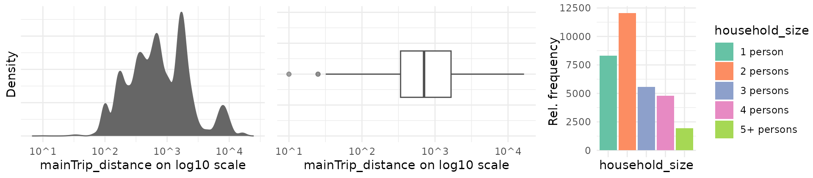

### 1D: One variable against age, period or cohort

Plotting the distribution of a variable against age, period or cohort is
possible with function `plot_variable`. The distribution of metric and
categorical variables is visualized using boxplots or line charts (see
argument `plot_type`) and bar charts, respectively. The latter by
default show relative frequencies, but can be changed to show absolute
numbers by specifying argument `geomBar_position = "stack"`.

``` r

plot_variable(dat = travel, y_var = "mainTrip_distance",
              apc_dimension = "period", plot_type = "line", ylim = c(0,1000))
```

    ## Warning in fortify(data, ...): Arguments in `...` must be used.
    ## ✖ Problematic argument:
    ## • col = gray(0.3)
    ## ℹ Did you misspell an argument name?

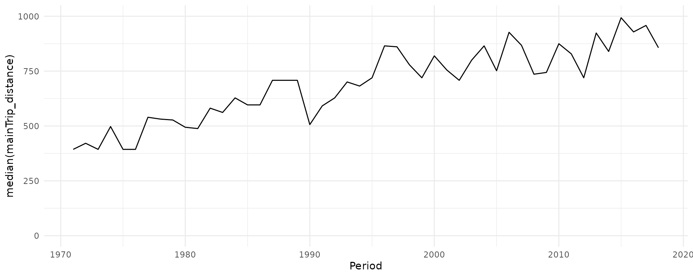

``` r

plot_variable(dat = travel, y_var = "household_size", apc_dimension = "period")
```

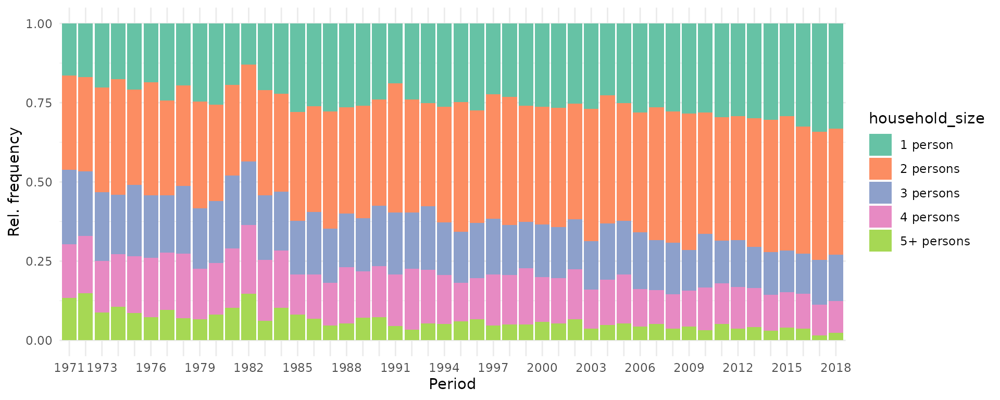

### 2D: Density matrices

To include all temporal dimensions in one plot, `APCtools` contains
function `plot_densityMatrix`. In Weigert et al. (2021), this plot type
was referred to as *ridgeline matrix* when plotting multiple density
plots for a metric variable. The basic principle of a density matrix is
to (i) visualize two of the temporal dimensions on the x- and y-axis
(specified using the argument `dimensions`), s.t. the third temporal
dimension is represented on the diagonals of the matrix, and (ii) to
categorize the respective variables on the x- and y-axis in meaningful
groups. The function then creates a grid, where each cell contains the
distribution of the selected `y_var` variable in the respective
category.

By default, age and period are depicted on the x- and y-axis,
respectively, and cohort on the diagonals. The categorization is defined
by specifying two of the arguments `age_groups`, `period_groups` and
`cohort_groups`.

``` r

age_groups    <- list(c(80,89),c(70,79),c(60,69),c(50,59),
                      c(40,49),c(30,39),c(20,29))
period_groups <- list(c(1970,1979),c(1980,1989),c(1990,1999),
                      c(2000,2009),c(2010,2019))

plot_densityMatrix(dat              = travel,
                   y_var            = "mainTrip_distance",
                   age_groups       = age_groups,
                   period_groups    = period_groups,
                   log_scale        = TRUE)
```

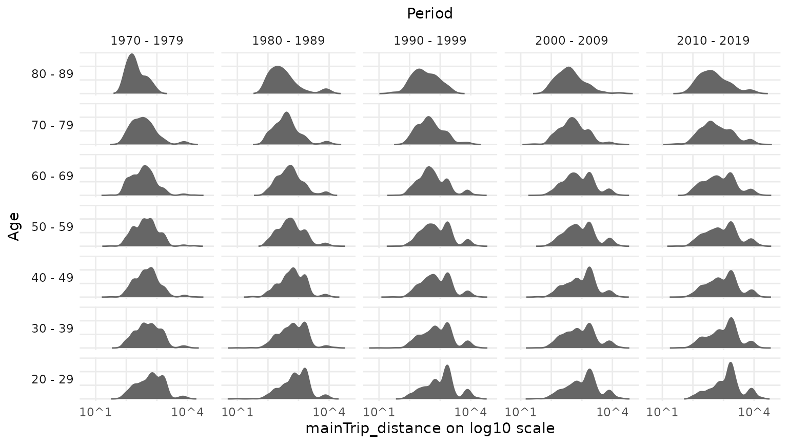

To highlight the effect of the variable depicted on the diagonal (here:
cohort), different diagonals can be highlighted using argument
`highlight_diagonals`.

``` r

plot_densityMatrix(dat                 = travel,
                   y_var               = "mainTrip_distance",
                   age_groups          = age_groups,
                   period_groups       = period_groups,
                   highlight_diagonals = list("born 1950 - 1959" = 8,
                                              "born 1970 - 1979" = 10),
                   log_scale           = TRUE)
```

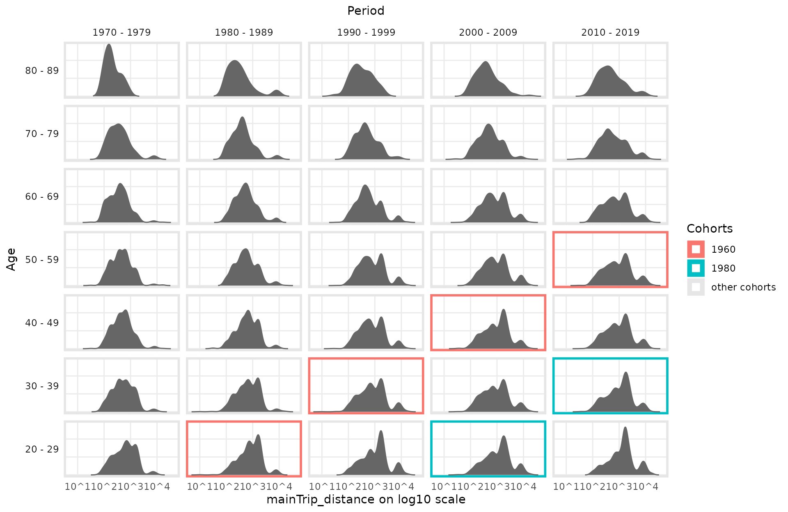

For metric variables it is further possible to use a color scale for the
density function (arguments `y_var_cat_breaks` and `y_var_cat_labels`)
to highlight local developments over the APC dimensions.

``` r

dist_cat_breaks <- c(1,500,1000,2000,6000,100000)
dist_cat_labels <- c("< 500 km","500 - 1,000 km", "1,000 - 2,000 km", "2,000 - 6,000 km", "> 6,000 km")

plot_densityMatrix(dat              = travel,
                   y_var            = "mainTrip_distance",
                   age_groups       = age_groups,
                   period_groups    = period_groups,
                   log_scale        = TRUE,
                   y_var_cat_breaks = dist_cat_breaks,
                   y_var_cat_labels = dist_cat_labels,
                   highlight_diagonals = list("born 1950 - 1959" = 8,
                                              "born 1970 - 1979" = 10),
                   legend_title     = "Distance category")
```

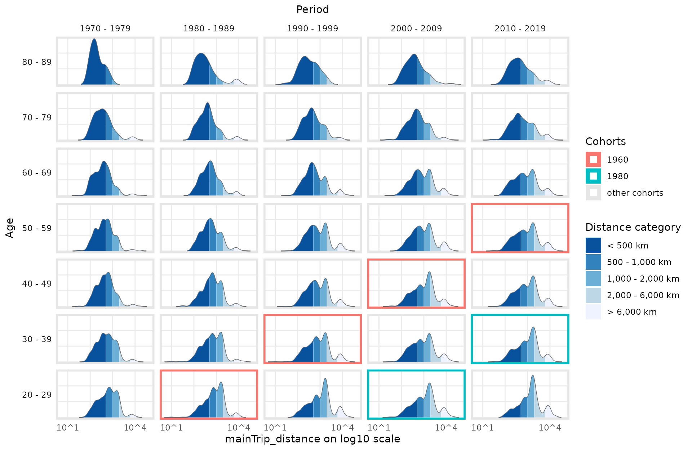

Alternatively to plotting a conditional density in each matrix cell,
metric variables can also be visualized using boxplots by specifying
`plot_type = "boxplot"`. Categorical variables are automatically plotted
using conditional bar plots.

``` r

plot_densityMatrix(dat                 = travel,
                   y_var               = "household_size",
                   age_groups          = age_groups,
                   period_groups       = period_groups,
                   highlight_diagonals = list("born 1950 - 1959" = 8,
                                              "born 1970 - 1979" = 10))
```

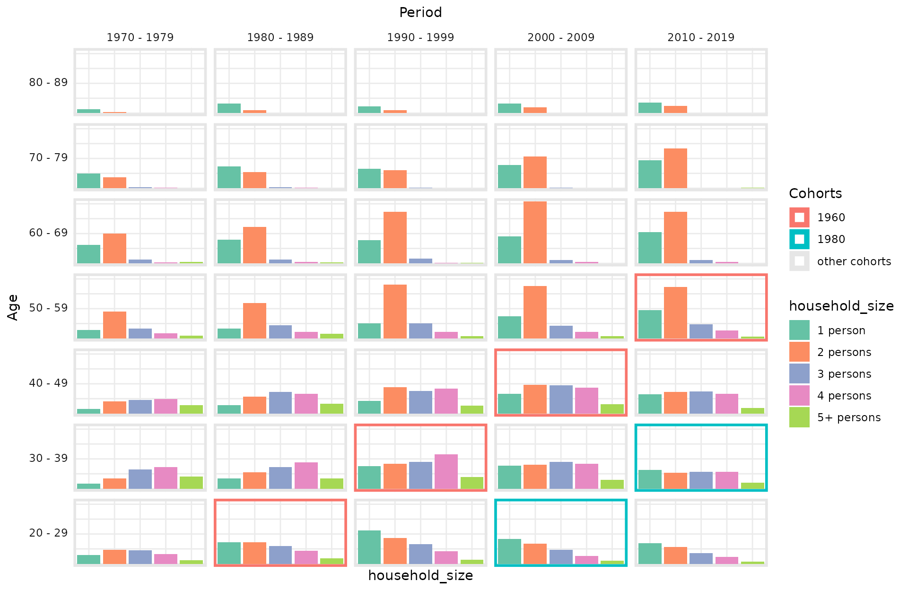

### 2D: Heatmaps

Similar to density matrices, heatmaps simultaneously visualize all three
APC dimensions. Instead of individual distributions in separated
categories, however, a color scale is used to depict the mean value in a
specific region. When setting `bin_heatmap = FALSE`, the function
`plot_APCheatmap` shows the average observed values of a metric variable
for each observed combination of age and period values (if
`dimensions = c("period","age")`). The borders of groups along the
diagonal can be marked using argument `markLines_list`.

``` r

plot_APCheatmap(dat            = travel,
                y_var          = "mainTrip_distance",
                y_var_logScale = TRUE,
                bin_heatmap    = FALSE,
                markLines_list = list(cohort = c(1900,1920,1939,1946,
                                                 1966,1982,1994)))
```

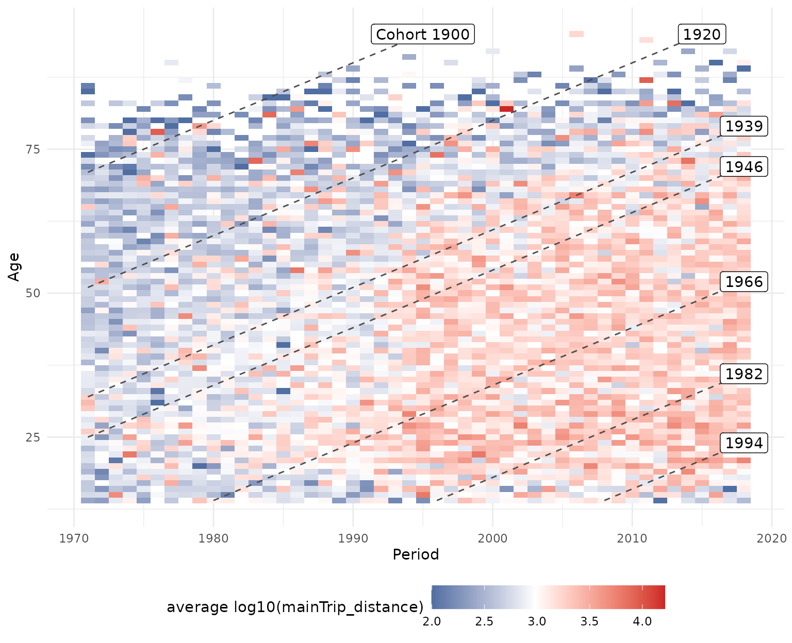

By default, the heatmap is binned in five year blocks along the x- and
y-axis to focus on larger-scale developments. Note that the grid used
for binning can flexibly be defined with the argument
`bin_heatmapGrid_list`.

``` r

plot_APCheatmap(dat            = travel,
                y_var          = "mainTrip_distance",
                y_var_logScale = TRUE,
                markLines_list = list(cohort = c(1900,1920,1939,1946,
                                                 1966,1982,1994)))
```

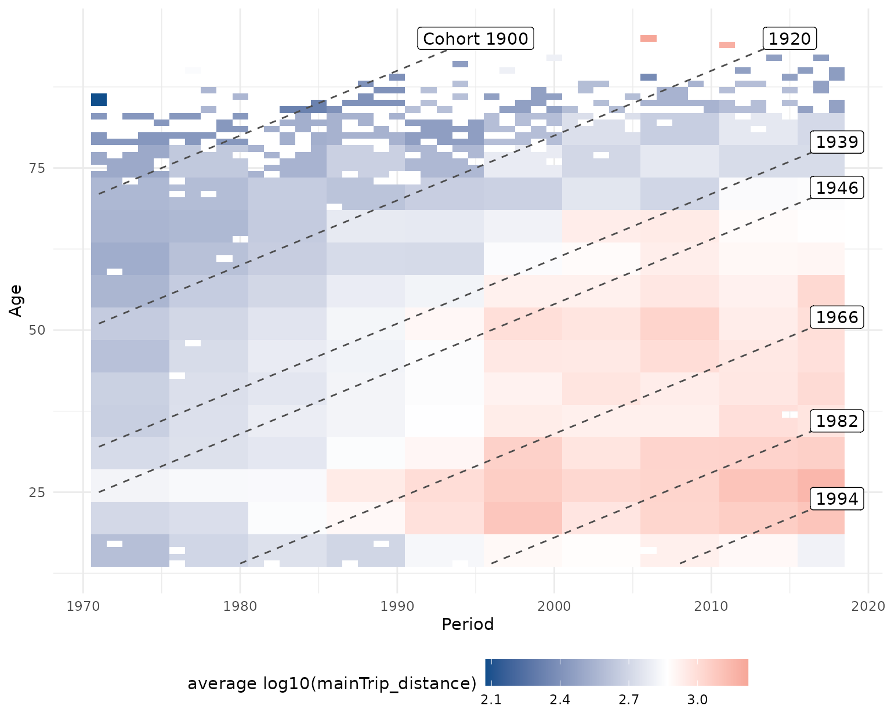

### 2D: Hexamaps

As an alternative to classical heatmaps observed developments can also
be visualized using *hexamaps*, i.e. hexagonally binned heatmaps with
rotated axes to give all three APC dimensions similar visual weight.
This resolves the central problem of classical heatmaps that
developments along the diagonal dimension are visually much harder to
grasp than developments along the x- or y-axis. Function
`plot_APChexamap` can be called similarly to `plot_APCheatmap`. Note,
however, that hexamaps are currently implemented using the base R plot
functions and not based on `ggplot2`.

``` r

plot_APChexamap(dat            = travel,
                y_var          = "mainTrip_distance",
                y_var_logScale = TRUE)
```

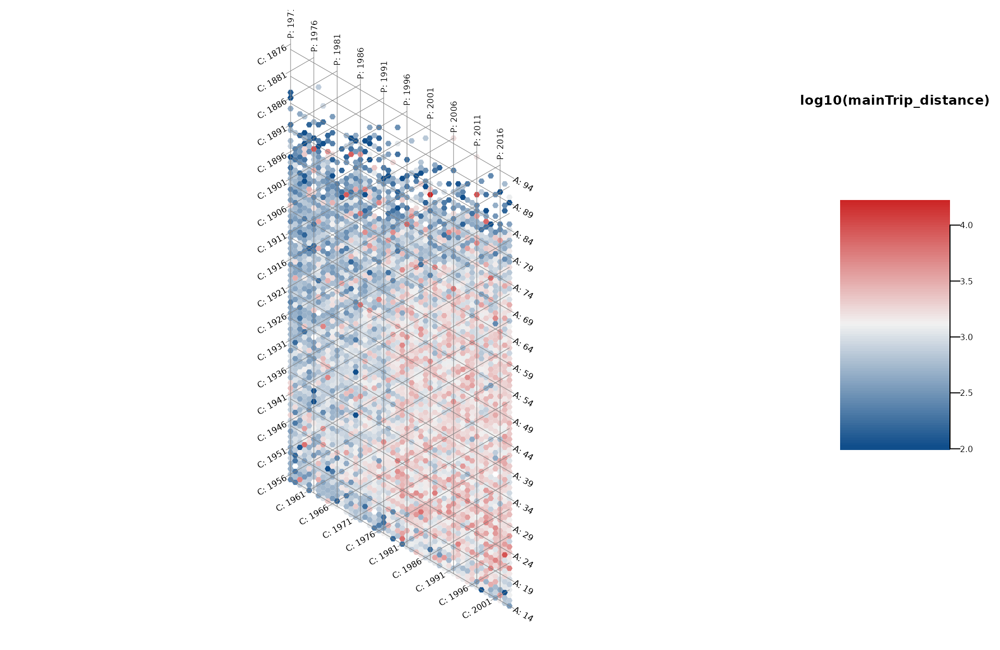

## Model-based analyses

After getting a descriptive overview of the data with the functions
outlined above, an established approach to analyze APC structures in
more detail is to use the semiparametric approach offered by generalized
additive regression models (GAMs). This regression-based approach offers
several benefits:

- Compared to alternative regression-based APC approaches it circumvents
  the issue of linear dependency of the APC dimensions by estimating a
  flexible two-dimensional tensor product surface.
- The model separates the underlying smooth effects of age, period and
  cohort from random variation in the data and allows for the subsequent
  visualization of marginal age, period and cohort effects.
- While the above heatmaps and hexamaps can only be used to visualize
  the observed distribution of *metric* variables, the regression-based
  approach also allows for estimating and plotting the mean structure in
  settings with a categorical response variable, for example by
  estimating a logistic regression model.
- The regression-based approach allows for accounting for further
  control variables in the model. E.g., when analyzing how travel
  distances developed over the last decades, each persons income can be
  included as a covariate in the model estimation to account for income
  differences between travelers in different decades.

For estimating a regression model we utilize the function `gam`
implemented in package `mgcv`. For further methodological details see
Weigert et al. (2021).

Let’s fit two GAM models, one without and one with further control
variables. See [`?travel`](../reference/travel.md) for an explanation of
the used variables. The tensor product surface is estimated with two
marginal P-spline bases with eight basis functions each.

``` r

# GAM without covariates
model_pure <- gam(mainTrip_distance ~ te(age, period, bs = "ps", k = c(8,8)),
                  data = travel)

# GAM including covariates
model_cov  <- gam(mainTrip_distance ~ te(age, period, bs = "ps", k = c(8,8)) +
                    residence_region + household_size + s(household_income),
                  data = travel)

# create a named list of the two models, useful for some functions
model_list <- list("pure model"      = model_pure,
                   "covariate model" = model_cov)
```

### Heatmaps

Similary to the descriptive visualization outlined above, the tensor
product surface estimated with the regression model can be created with
`plot_APCheatmap`, by passing the model object as argument `model` to
the function.

``` r

plot_APCheatmap(dat   = travel,
                model = model_pure)
```

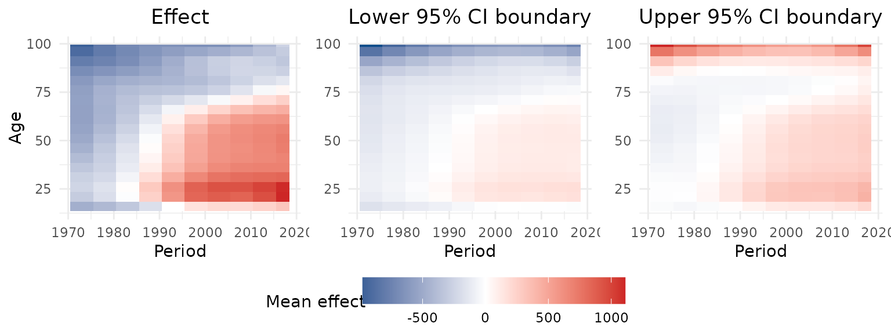

### Hexamaps

The same applies to the hexamaps. By calling `plot_APChexamap` and
specifying the `model` argument, a hexamap of the estimated mean
structure is created.

``` r

plot_APChexamap(dat   = travel,
                model = model_pure)
```

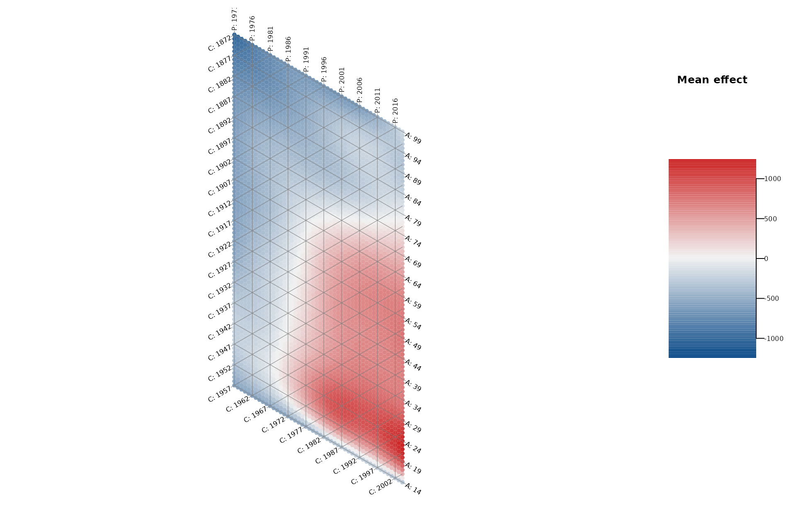

### Marginal APC effects

Based on the tensor product surface estimated through the regression
model, marginal effects can be extracted by taking the average of all
values on the surface along one dimension. Marginal effects can be
visualized using `plot_marginalAPCeffects`.

``` r

plot_marginalAPCeffects(model    = model_pure,
                        dat      = travel,
                        variable = "age")
```

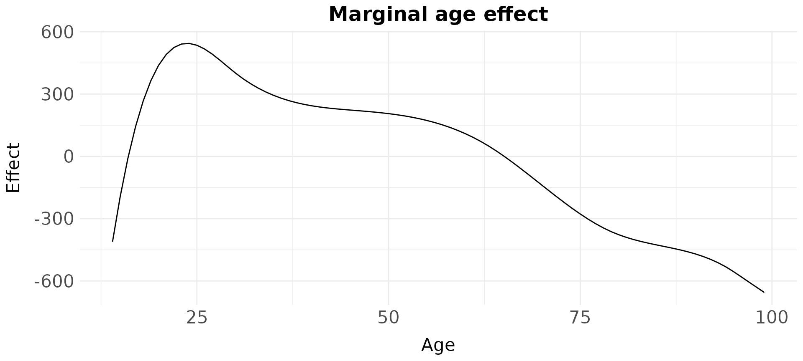

The marginal effects of multiple models can also be visualized in one
plot using `plot_jointMarginalAPCeffects`.

``` r

plot_jointMarginalAPCeffects(model_list  = model_list,
                             dat         = travel,
                             vlines_list = list("cohort" = c(1900,1920,1939,
                                                             1946,1966,1982,
                                                             1994)))
```

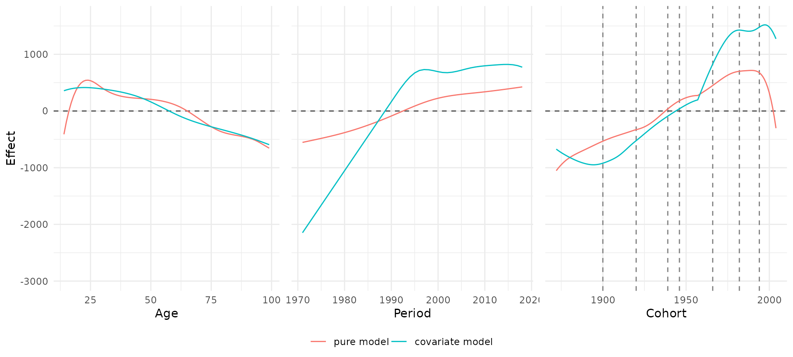

### Partial APC plots

partial APC plots can be used to get deeper insights into a specific
temporal effect and the interrelations between the temporal dimensions.
These plots show the estimated effect for one temporal dimension
dependent on the remaining two dimensions. The mean marginal effect is
marked as a bold blue line, and one grayscale line is added for each
partial effect, that is, for the estimated differences when just
focusing on a specific age, period or cohort group.

In the following example, the period effect is visualized, dependent on
different age groups and cohorts. See [Weigert et
al. (2021)](https://doi.org/10.1177/1354816620987198) for details on the
interpretation of partial APC plots.

``` r

plot_partialAPCeffects(model    = model_pure,
                       dat      = travel,
                       variable = "period")
```

    ## Warning: Using `size` aesthetic for lines was deprecated in ggplot2 3.4.0.
    ## ℹ Please use `linewidth` instead.
    ## ℹ The deprecated feature was likely used in the APCtools package.
    ##   Please report the issue at <https://github.com/bauer-alex/APCtools/issues>.
    ## This warning is displayed once per session.
    ## Call `lifecycle::last_lifecycle_warnings()` to see where this warning was
    ## generated.

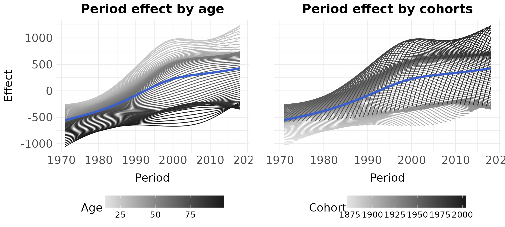

### APC summary table

The function `create_APCsummary` can be used to get a compact overview
of the magnitude of the individual APC effects. It extracts information
about the minimum and maximum values of the marginal APC effects and
computes the overall size of each effect.

``` r

create_APCsummary(model_list = model_list,
                  dat        = travel)
```

| model | effect | value_withMaxEffect | value_withMinEffect | max_effect | min_effect | difference |
|:---|:---|---:|---:|---:|---:|---:|
| pure model | age | 24 | 99 | 543.75 | -655.35 | 1199.10 |
| pure model | period | 2018 | 1971 | 424.94 | -553.66 | 978.60 |
| pure model | cohort | 1989 | 1872 | 715.82 | -1052.50 | 1768.32 |
| covariate model | age | 22 | 99 | 414.07 | -593.46 | 1007.53 |
| covariate model | period | 2015 | 1971 | 821.62 | -2147.34 | 2968.97 |
| covariate model | cohort | 1997 | 1894 | 1519.87 | -948.62 | 2468.49 |

### Covariate effect plots

Control variables in the regression models can be visualized using the
functions `plot_linearEffects` and `plot_1Dsmooth` which create an
effect plot of all linear effects in a model and a line plot of a
one-dimensional smooth effect, respectively.

``` r

APCtools::plot_linearEffects(model_cov)
```

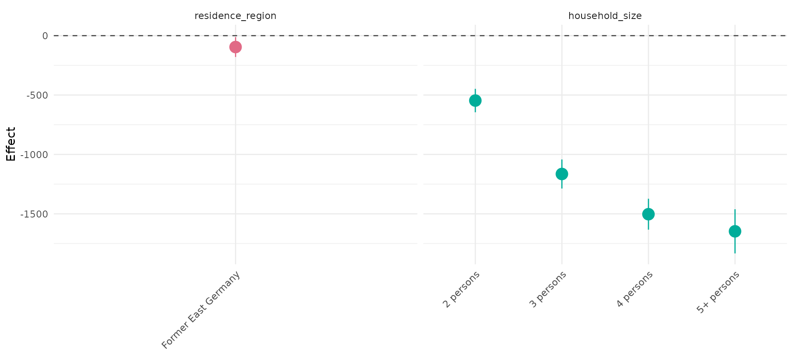

``` r

APCtools::plot_1Dsmooth(model_cov, select = 2)
```

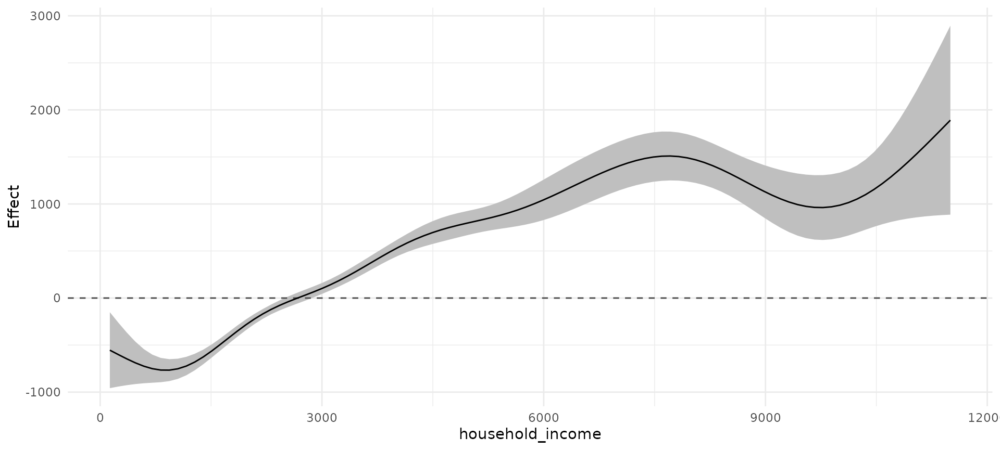

### Model summary tables

The function `create_modelSummary` can be used to create
publication-ready tables of the full model results. It can either be
applied to a list of multiple models or a list of a single model, and
returns a list with both a table for all linear coefficients and all
nonlinear estimates.

``` r

summary_list <- create_modelSummary(model_list)
summary_list[[1]]
```

| model | param | coef | se | CI_lower | CI_upper | pvalue |
|:---|:---|---:|---:|---:|---:|:---|
| pure model | (Intercept) | 1417.52 | 13.59 | 1390.88 | 1444.15 | \- |
| covariate model | (Intercept) | 2327.09 | 39.99 | 2248.71 | 2405.47 | \- |
| covariate model | residence_regionFormer East Germany | -95.93 | 42.68 | -179.57 | -12.28 | 0.0246 |
| covariate model | household_size2 persons | -546.46 | 50.28 | -645.02 | -447.91 | \<.0001 |
| covariate model | household_size3 persons | -1164.62 | 62.36 | -1286.85 | -1042.39 | \<.0001 |
| covariate model | household_size4 persons | -1503.18 | 66.39 | -1633.31 | -1373.06 | \<.0001 |
| covariate model | household_size5+ persons | -1647.24 | 94.85 | -1833.14 | -1461.34 | \<.0001 |

``` r

summary_list[[2]]
```

| model           | param               |   edf | pvalue  |
|:----------------|:--------------------|------:|:--------|
| pure model      | te(age,period)      | 28.74 | \<.0001 |
| covariate model | te(age,period)      | 18.54 | \<.0001 |
| covariate model | s(household_income) |  8.27 | \<.0001 |
